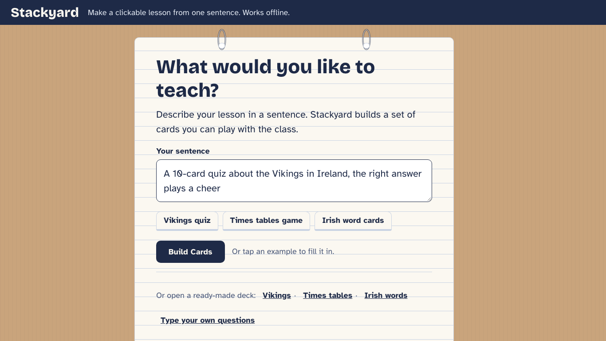
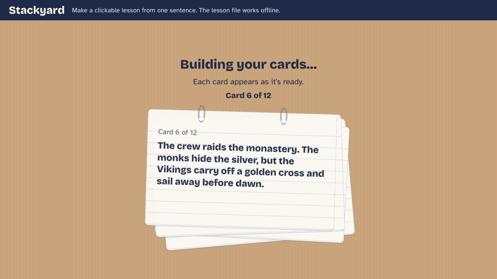
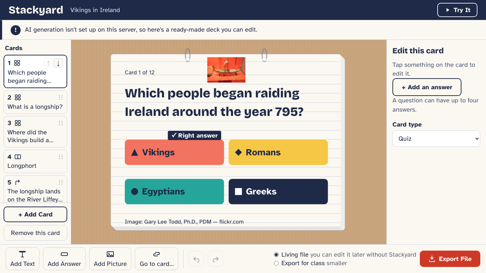
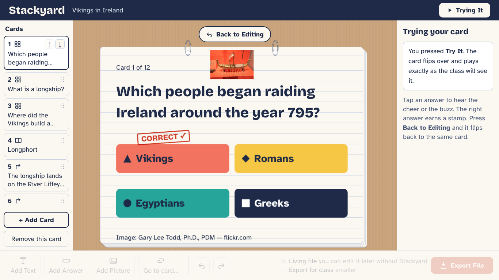
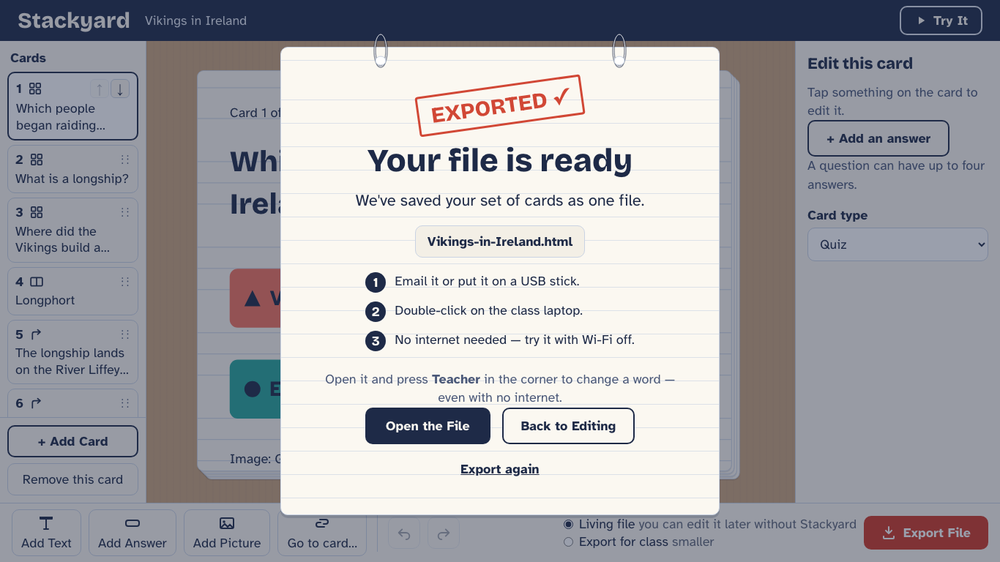
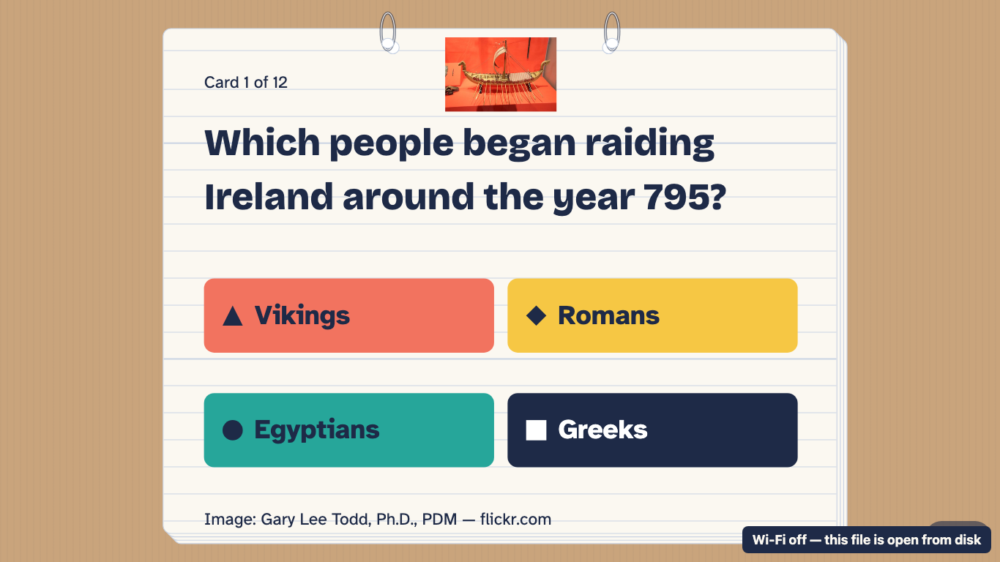
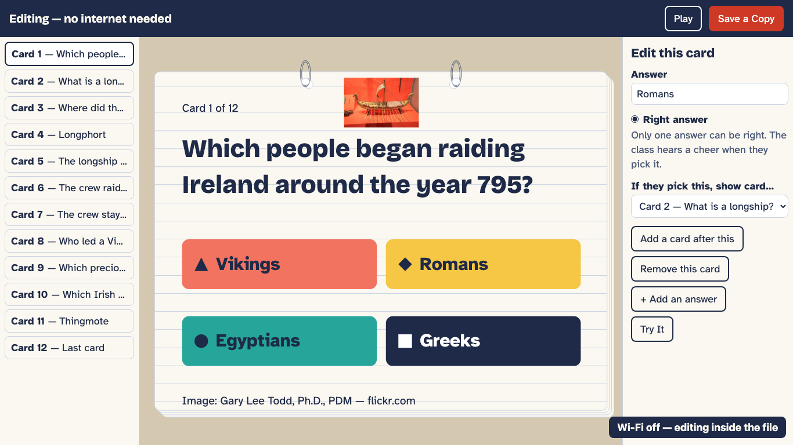
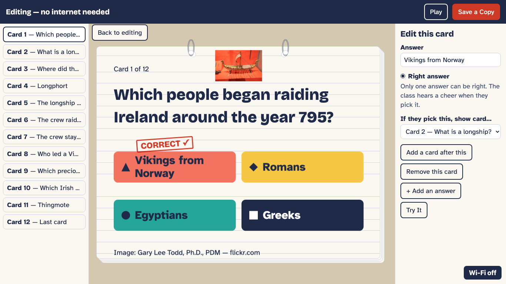
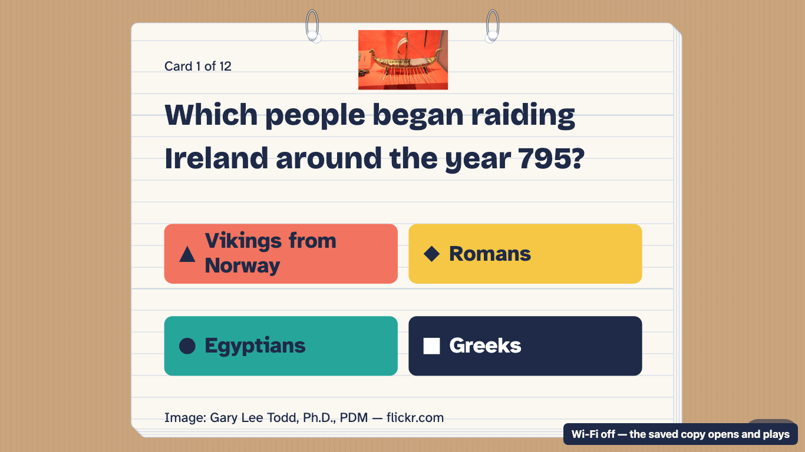

# Stackyard

Make a clickable lesson from one sentence. The **lesson is the file**: one HTML file you can hand to a class, which plays, scores and edits itself offline. HyperCard revivals usually bring back the editor; Stackyard brings back the stack you could hand to someone. (The Maker, where you make the lesson, needs the internet; only the file works offline.)

Inspired by HyperCard. Built for Kiroween 2026 with Kiro.

**Demo video (2:52):** https://youtu.be/G5aNDWg8UGY · **Live app:** https://stackyard-sdqt.onrender.com

## What it is

A teacher types one sentence — "a 10-card quiz about the Vikings in Ireland, the
right answer plays a cheer" — and Stackyard builds a set of interactive lesson
cards (quiz, flashcards, a branching story, a score card). The teacher can edit
any card (move a button, change an answer, link a card to another) and then
**export the whole lesson as one self-contained HTML file**. That file is built for ES2018 and plays offline in Chrome (checked by our gates) and, in a one-off run, in Playwright's Firefox and WebKit builds, with no internet, no account and no install.

Two halves:

- **The Maker** (the editor) is a web app. It needs the server once, to generate
  and to export. Generation calls a model server-side; if the model is
  unavailable the Maker hands back a ready-made deck you can edit (and says so).
- **The Player** is the exported file. It is fully offline: all fonts and the
  runtime are inlined; it makes **zero network requests**.

"Works offline" means the **exported lesson file**, not the Maker. We ran those
files with the network off in Playwright's Chromium, Firefox and WebKit builds
(run on 6 Nov on files exported before TASK-29/30) (0 requests, 0 errors; real Safari and Windows were not tried): see
[`docs/cross-browser/`](docs/cross-browser/).

### The living file

The default export is a **living file**: it plays exactly like the plain class
file, and a small **Teacher** tab in the corner opens a lighter editor *inside the
file*, built on the same validated edit operations as the Maker. A teacher can fix
a typo, change which answer is right, add or remove a card, drag on quiz and story cards (not flash or end cards, which keep their own layout) with Undo, press **Try It**, and
**Save a Copy** (a new file, named `<title> (copy).html`) on a class laptop with
the Wi-Fi off. The copy is itself a living file. "Export for class (smaller)" is
the play-only alternative.

## See it

<!-- The screens below are real: `scripts/make-readme-media.ts` drives the built
     Maker in headless Chrome and writes docs/media/ (re-run it after a UI change). -->


The README screens and the GIF use the ready-made Vikings deck (no live generation): `npm run media` regenerates them against a server with no model key, so the ready-made deck answers. The live app uses the model.

| 1. The sentence | 2. Cards deal in | 3. Edit any card |
|---|---|---|
|  |  |  |

| 4. Try It: the rubber stamp | 5. One file | 6. The file, network off |
|---|---|---|
|  |  |  |

| 7. Teacher: make the right answer more exact | 8. Try It: the stamp lands there | 9. Save a Copy: the copy plays |
|---|---|---|
|  |  |  |

The GIF ends the same way: the file exported in screen 5 is opened from disk with
the network switched off (screen 6), edited in its own Teacher tab, and the copy it
saves is opened and played (screen 9).

- **Live app:** https://stackyard-sdqt.onrender.com (the GitHub About "Website"
  field points at this URL; it is set by hand in the repository settings, not by
  anything in the code).
- **Three sample lessons, no server needed.** Download one and double-click it,
  with the Wi-Fi off if you like. They are living files, so try the Teacher tab.
  - [`samples/vikings-in-ireland.html`](samples/vikings-in-ireland.html) — quiz,
    a flash card and a branching story
  - [`samples/times-tables.html`](samples/times-tables.html) — a quiz game
  - [`samples/irish-words.html`](samples/irish-words.html) — flashcards and a quiz

  They are generated from the ready-made decks by `npm run samples`.

## Built with Kiro

Stackyard was planned and built in Kiro. The pieces, and where to look:

- **Steering** — five always-on files describe the product, audience, tech,
  stack format and design system: [`.kiro/steering/`](.kiro/steering/).
- **Specs** — requirements, design and tasks for four features (the Maker, the
  stack generator, the exporter and the curriculum bench), each written by Kiro from a chat request
  and then reviewed: [`.kiro/specs/`](.kiro/specs/). `npm run check:trace`
  fails if a lettered task id in the specs is not mentioned by a test, a gate
  script or a hook; today it reports the true count (see its output, not a
  claim in this file).
- **Hooks** — six hooks (invariants on save, living-file gate, export check,
  ready-made content check, `invariants-after-shell-edit` — a `PostToolUse` hook
  on the agent's shell commands that re-runs the invariants after a shell edit —
  and a `pre-submit` gate set to fire when a spec task is marked done (not yet recorded firing; run on demand as `/pre-submit`)):
  [`.kiro/hooks/`](.kiro/hooks/). Kiro's session store recorded 493 hook
  firings in our main session (5 to 9 Nov), counted per hook in
  [`docs/kiro-sessions/`](docs/kiro-sessions/).
- **Custom agent** — the lesson checker that reads a set of cards (we ran it on
  the ready-made decks) for factual errors, ambiguous questions and reading
  level: [`.kiro/agents/`](.kiro/agents/).
- **MCP server** — `mcp/openverse` finds public-domain pictures for the
  ready-made decks; its search and allowlisted-fetch code was run as a script
  outside Kiro (Kiro's sandbox had no network) to pick them.
- **Property-based tests** — every stack invariant has a `fast-check` property.
- **Excerpts** from real Kiro sessions (the TASK-26 prompt, hook firings, the
  lesson-checker run): [`docs/kiro-sessions/`](docs/kiro-sessions/). The running
  log of what Kiro did and what we did outside it is
  [`docs/KIRO_LOG.md`](docs/KIRO_LOG.md).

## Why HyperCard

HyperCard let non-programmers build clickable, branching "stacks" in 1987.
Successors like HyperStudio and Decker exist; we have not found one that starts from a teacher's sentence. Stackyard brings that back for a teacher
with patchy classroom Wi-Fi: the authoring input is a sentence, the output is a
scored lesson the class plays, every stack satisfies nine validity invariants, and a 'before you share' check warns if any card can't reach the end score, and the exported file is re-importable
(round-tripped losslessly, checked by a 1,000-run property test).

## Prior art (and what we haven't found elsewhere)

- **Decker** (a modern HyperCard-tradition tool) exports one offline HTML with
  the runtime inside — but it has no generation and uses a scripting language.
- **H5P / Lumi** export an offline interactive activity for teachers, but authoring is per content type, and H5P.com's Smart Import drafts from a document, link or long pasted text, not one sentence.
- **AI quiz makers** turn a topic into a quiz — but they usually live on a platform that needs accounts, or export to forms, LMS formats or PDF.

What we haven't found elsewhere: **a teacher's sentence → a validated, branching,
always-playable stack → direct card editing → one self-contained offline file that
can edit itself and save a copy of itself, offline.**

## Libraries and model

| Dependency | Role | Licence |
|---|---|---|
| Preact | the Maker UI (only runtime UI dependency) | MIT |
| tsx | run/transpile TypeScript for the server | MIT |
| Vite | dev server + builds (Maker SPA, player IIFE) | MIT |
| Vitest | test runner | MIT |
| fast-check | property-based tests | MIT |
| jsdom | DOM for player/UI tests | MIT |
| TypeScript | strict type checking | Apache-2.0 |

The generator calls an **OpenAI-compatible** chat endpoint, configured on the
live deploy for **Anthropic** (`STACKYARD_LLM_BASE_URL` / `STACKYARD_LLM_MODEL`).
The model is used **only in the Maker, at build time** — it never runs in, and
is never inlined into, the exported file. Fonts are listed under
[Third-party assets](#third-party-assets).

## By the numbers

These figures are checked against the code by `scripts/check-claims` (run by the
`pre-submit` hook), so the docs can't drift:

- Tests: **1296** passing (`npm test`).
- Player bundle: **13.6 KB** gzipped (budget 50 KB).
- Stack invariants: **9** (enforced by `src/shared/validator.ts`).
- Round-trip property test: **1,000** runs (stack → HTML → stack, lossless).
- Floppy test: **7** lesson files like the water-cycle test deck fit on a 1.44 MB floppy
  (1,457,664 bytes). That is a living export of
  `tests/fixtures/generation/water-cycle-g2.json`, sized by `tests/export-size.test.ts`.
  The ready-made samples in `samples/` carry photos, so they are larger.
- Curriculum bench: 54 of 55 England KS2 science objectives (Years 3–5) became a valid lesson file on the first try; 48 passed our automatic lesson check with no warnings ([`bench/RESULTS.md`](bench/RESULTS.md)). The checks are mechanical (structure, counts, answer overlap) and do not verify facts. It measures the generator against curriculum objectives; it is not a classroom study and no teacher or pupil was involved.
- A read-only AI review of 60 quiz cards from 12 generated decks found 0 wrong keys and 2 ambiguous ones (bench/LESSON_CHECKER.md). It is an AI review, not a teacher's.
- Accessibility: axe-core 4.14.0 audited 14 pages (the Maker, the 3 samples in Play and in the Teacher tab, a class export and 5 bench files) and found 0 serious or critical violations; the keyboard-only play-through passes and the one-switch scan play-through passes ([`docs/accessibility/`](docs/accessibility/README.md)). No screen-reader user or disabled pupil has tested it.

The **curriculum bench** ([`bench/`](bench/README.md)) runs all 55 statutory Years 3–5
objectives of England's KS2 science programme of study through the generator. It
measures the generator against curriculum objectives; it is not a classroom study.
`check:claims` requires its result line in this list whenever `bench/results.json`
exists.

## Development

**The Devpost write-up lives in this repo** at
[`docs/DEVPOST_WRITEUP.md`](docs/DEVPOST_WRITEUP.md) (it used to be a draft
outside the repository). `npm run check:claims` checks its numbers the same way
it checks this README.

Install dependencies with `npm ci`, then:

- `npm test` — rebuilds the player bundle and runs the full Vitest suite
  (unit, integration, and property tests). The suite includes a size guard
  that fails if the gzipped player bundle exceeds 50 KB.
- `npm run typecheck` — runs `tsc --noEmit` in strict mode.
- `npm run build:player` — bundles the player runtime
  (`src/player/`) into `dist/player/player.iife.js`.

### Keeping the player bundle fresh

The player runtime is pre-built into `dist/player/player.iife.js`, which is
committed to the repo so the exporter can inline it without re-bundling. After
changing anything under `src/player/`, rebuild and commit the bundle:

```sh
npm run build:player
```

GitHub Actions (`.github/workflows/ci.yml`) runs `npm test`, `npx tsc --noEmit`,
`scripts/check-player-fresh.sh`, `npm run check:samples` and `npm run check:claims`
on every push and pull request. The
freshness script rebuilds the player into a temporary directory and compares it
with the committed file:

```sh
./scripts/check-player-fresh.sh
```

It exits `0` when the committed bundle matches a fresh build and `1` when they
differ (i.e. the source changed but the bundle was not rebuilt).

### Screenshotting the Maker screens

`screens.html` + `src/screens-harness.tsx` render one Maker screen state at a
time (`?state=<name>`) so headless Chrome can capture them for comparison with
the mockups in `docs/design/maker/`. Two ways to shoot into
`docs/design/maker/built/`:

```sh
# With the dev server running (npm run dev:maker):
zsh scripts/shoot.sh [state ...]

# Without a server — build once, then shoot over file://:
npx vite build --base=./
zsh scripts/shoot-file.sh [state ...]
```

Each state is captured at 1366×768 (the target laptop) and 1920×1080 (a
classroom projector). `shoot-file.sh` passes Chrome `--allow-file-access-from-files`
so the built ES modules load from a `file://` URL.

## Run it / Deploy it

Stackyard runs as **one web service**: the same Node server serves the built
Maker SPA and answers the `/api` routes, so there is a single thing to deploy.

Run the production server locally:

```sh
npm ci
npm run build:player   # bundles the player runtime
npm run build:living   # bundles the living-file runtime (editor + Save a Copy)
npm run build:maker    # builds the Maker SPA into dist/maker
npm start              # serves dist/maker + /api on PORT (default 3001)
```

Then open `http://localhost:3001`. `npm start` sets `NODE_ENV=production`, which
turns on static serving. Without a model key the generator falls back to the
built-in ready-made decks, so the app still works with no model key. (The Maker
itself still needs its server; only the exported file works offline.)

Environment variables (server-only; the model key never reaches the browser):

| Variable | Purpose | Default |
|---|---|---|
| `STACKYARD_LLM_API_KEY` | Model API key (set in the host's dashboard, never committed) | — |
| `STACKYARD_LLM_BASE_URL` | OpenAI-compatible endpoint (live deploy uses Anthropic) | `https://api.openai.com/v1` |
| `STACKYARD_LLM_MODEL` | Model name | `gpt-4o-mini` |
| `STACKYARD_LLM_JSON_MODE` | `off` omits `response_format: json_object`. Some OpenAI-compatible endpoints reject it (Anthropic's does); the prompt still asks for JSON and the validator plus one retry still guard the result | on |
| `STACKYARD_LLM_TEMPERATURE` | `off` omits `temperature`, which some newer models reject | on |
| `STACKYARD_LLM_MAX_TOKENS` | Output token budget, clamped to 1,000–32,000. Raise it if a 10-card deck arrives cut off ("Unterminated string") | `4096` |
| `STACKYARD_LLM_THINKING` | `off` sends `"thinking": {"type": "disabled"}`; `on` sends nothing. Anthropic's endpoint thinks for 20 to 24 s before its first word unless told not to (measured: whole stack in 11 s with it off, 30 to 33 s on). Other hosts may reject the field | `off` for `api.anthropic.com`, `on` (nothing sent) for any other host |
| `PORT` | Port to listen on | `3001` |
| `TRUST_PROXY` | `1` behind a trusted proxy (e.g. Render), so a forwarding header is used for the client's rate-limit identity | off |
| `CLIENT_IP_HEADER` | the single-value client-IP header the proxy sets; on Render set to `cf-connecting-ip`. Falls back to the rightmost `X-Forwarded-For` entry (never the client-controlled leftmost) | — |
| `DEBUG_CLIENT_ADDR` | `1` logs the forwarding headers + chosen client address for the first few generate requests (temporary diagnostics) | off |
| `GENERATE_RATE_PER_10MIN` | Per-client generate limit per 10 minutes (schools share one address) | `20` |
| `EXPORT_RATE_PER_10MIN` | Per-client export limit per 10 minutes | `60` |
| `GENERATE_DAILY_CAP` | Global real model calls per UTC day; over the cap the app serves ready-made decks | `300` |

Because the public instance holds a paid key, `/api/generate` has two guards:

- a **per-client rate limit** — over it, the request gets a friendly **HTTP 429**
  with a `Retry-After` header and a plain message (not a deck); the Maker's
  start screen then offers ready-made decks you can open locally; and
- a **global daily budget** — once the day's real model calls are spent, the
  request is served from the offline ready-made decks and makes no model call.

A request that is served from a ready-made deck (budget spent, or no key) makes
no model call and does not consume a per-client rate-limit slot.

### Deploy to Render (free web service)

`render.yaml` is a one-service blueprint. In Render, choose **New → Blueprint**,
point it at this repo, and set `STACKYARD_LLM_API_KEY` in the dashboard (it is
`sync: false`, so it is never read from the repo). The build runs
`npm ci && npm run build:player && npm run build:living && npm run build:maker`, the service starts with
`npm start`, and `/api/health` is the health check (a cheap keep-warm ping that
makes no model call).

**Keep-warm.** The GitHub Actions workflow is installed as
`.github/workflows/keep-warm.yml` on GitHub and runs every 10 minutes: it pings
`/api/health`, with one retry, no secrets and no repository permissions.
[`docs/ops/keep-warm.yml`](docs/ops/keep-warm.yml) is the reviewed copy (a token
without the `workflow` scope can't push workflow files, so it was installed through
the GitHub web editor; a test checks the two are byte-identical when both are
present). GitHub may delay scheduled runs, so a free instance can still be cold
after a quiet spell: the first load then takes up to a minute.

## Third-party assets

Stackyard ships two open-source typefaces and three public-domain pictures (one Public Domain Mark, two CC0). The fonts are self-hosted (no CDN) as
Latin-subset `woff2` files and, in exported stacks, inlined as base64 inside
the single HTML file. The SIL Open Font License 1.1 lets us embed and
redistribute these fonts, but requires that the copyright notice and licence
travel with them, so the obligations below apply to this repo and to every
exported file.

| Font | Used as | Copyright | Licence | Reserved Font Name | Source |
|---|---|---|---|---|---|
| Bricolage Grotesque | Headings (`font-family: "Bricolage Grotesque"`) | Copyright 2022 The Bricolage Grotesque Project Authors | SIL Open Font License 1.1 | None | https://github.com/ateliertriay/bricolage |
| Atkinson Hyperlegible | Body text, shipped as a Latin subset under the renamed family `"Stackyard Reading"` | Copyright 2020 Braille Institute of America, Inc. | SIL Open Font License 1.1 | "Atkinson", "Hyperlegible" | https://github.com/googlefonts/atkinson-hyperlegible |
| Bricolage Grotesque (digits only) | The ten digits 0–9 on tiles and body text, so a zero is never slashed (`font-family: "Stackyard Digits"`, made by `scripts/make-digits-font.py`) | Copyright 2022 The Bricolage Grotesque Project Authors | SIL Open Font License 1.1 | None | https://github.com/ateliertriay/bricolage |

Full licence text (with each copyright line) lives next to the font files:

- `docs/design/maker/fonts/OFL-BricolageGrotesque.txt`
- `docs/design/maker/fonts/OFL-AtkinsonHyperlegible.txt`

The same `OFL-*.txt` files travel with the fonts when they move to
`src/assets/fonts/` for the app and player.

**Reserved Font Name note.** Atkinson Hyperlegible reserves the names
"Atkinson" and "Hyperlegible". Under the OFL, a subset deletes glyph
components and so counts as a Modified Version, which may not present a
Reserved Font Name to users. The subset is therefore referenced under the
non-reserved family name **"Stackyard Reading"**; only its codepoint coverage
is reduced, the outlines are unchanged. Bricolage Grotesque declares no
Reserved Font Name, so it keeps its name.

Both fonts are also disclosed in the Devpost "libraries / assets" list.

### Pictures

Generated cards can carry one small drawing too: the model names a picture from a set of 42 pictograms that we drew ourselves (sun, cloud, rain, river, ship, castle, book and so on; MIT, like the code), and the server draws it from that set. No model text ever becomes picture data and nothing is fetched. The cards carry no credit line (the drawings are ours, so the child's card stays clean); this README is the credit: the pictograms are "Stackyard pictograms", MIT, like the code. A picture that would name a quiz's right answer is dropped. The teacher can swap or remove it in the Maker (Picture list) or add their own photo with Add Picture.

Each ready-made deck carries one picture (three photographs, none showing people), inlined as a data URI and credited
on the card (creator, licence, source domain). We found them on
Openverse (`mcp/openverse`, `npm run pick:images`) and fetched them through
Openverse's thumbnail proxy. The Viking ship is marked Public Domain Mark 1.0 by
its Flickr uploader, which is a statement, not a licence. The abacus and the
Cliffs of Moher are dedicated CC0 1.0 by their photographers.

| Deck | Picture | Creator | Licence | Source |
|---|---|---|---|---|
| Vikings in Ireland | A photograph of a model Viking ship | Gary Lee Todd, Ph.D. | Public Domain Mark 1.0 | https://www.flickr.com/photos/101561334@N08/54663235921 |
| Times Tables Game | A photograph of a large wooden abacus (Soda Hall, UC Berkeley), no people | Chiara Coetzee | CC0 1.0 | https://www.flickr.com/photos/29507259@N02/6773900929 |
| Everyday Words in Irish | A photograph of the Cliffs of Moher, no people | m.jan.adamczyk | CC0 1.0 | https://www.flickr.com/photos/182827575@N08/48339221481 |

The on-card credit shows only the domain (`Image: Gary Lee Todd, Ph.D., PDM —
flickr.com`) so it fits the card; selecting the credit in the Maker shows the
full link.

### Demo video: music and generated footage

The demo video is not part of the app. Its music was generated by the team with
ElevenLabs Music on a paid plan, on 27 Oct 2026 for an earlier project of ours,
and reused here (details: [`docs/MUSIC_LICENCE.md`](docs/MUSIC_LICENCE.md)). The classroom shots are dramatised: the teacher, the pupils, the laptops and the room are AI-generated (about 28 s, ten shots), each tagged on screen; app screens in them are real recordings composited in.

### Design reference image (AI-generated)

`docs/design/reference-stamp-pad-tiles.png` is an **AI-generated concept image**
used early on to choose the visual direction (paper, rings, coloured tiles). It
is **not a screenshot of Stackyard** and no part of the shipped UI is copied from
it. The PNG carries its generator's provenance metadata. See also
[`docs/design/README.md`](docs/design/README.md).

## Accessibility: answer tiles carry a shape as well as a colour

Every answer tile pairs its colour with a permanent shape (coral ▲, sun ◆,
teal ●, navy ■), so a colour-blind pupil can say "the triangle" and a washed-out
projector can't make two answers look alike. Shape-plus-colour coding is a
common accessibility pattern; our palette, type and rubber-stamp feedback are
our own. Answers also meet the 4.5:1 contrast rule and
a 56 px minimum height; see `.kiro/steering/design-system.md`.
